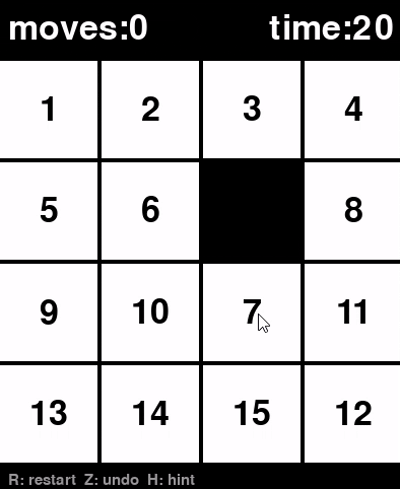

# fifteen-puzzle
PythonとPygameで作った15パズル。A*によるヒント機能付き。



## How to install(Windows)
```
git clone https://github.com/Shugo193/fifteen-puzzle.git
cd fifteen-puzzle
python -m venv .venv
.venv\Scripts\activate
pip install -r requirements.txt
python game.py
```
## How to play
- 空白の隣のタイルをクリックして動かす。
- R: リスタート  
- Z: 1手戻す  
- H: ヒント


## Features
### スライドアニメーション
クリックしたタイルが滑らかにスライドする。

### 1手戻す
Zキーで何手でも戻せる。
###  A*によるヒント機能
Hキーで次に動かすべきタイルが黄色に光る。

## Design decisions
### ロジックと描画を別々で作成
盤面のルール(`board.py`)と画面の描画(`game.py`)を別のファイルに分け、`board.py`はPygameを一切使わないようにした。描画側が盤面を呼び出す一方向の関係にしたことで、テストやA*で盤面ロジックだけを再利用できた。

### 必ず解けるシャッフル
タイルをランダムに並び替えると、解けない盤面になる場合がある。そこで、完成形から合法な手だけを繰り返して崩し、必ず解ける盤面だけができるようにした。直前の手をすぐ戻すのを除き、効率的に混ざるようにした。

### 盤面の状態と見た目を分けたスライドアニメーション
タイルをクリックすると一瞬で入れ替わっていた。盤面の状態と見た目の位置を分け、毎フレーム残りの距離の20%近づけた。結果、`board.py`を変えずに済み、Undoにもアニメーションをつけることができた。

### タイルが止まってからクリア演出
タイルが動いている途中にクリア演出が出ていた。最後のタイルが滑り込むのを見てからの方が気持ちいいと思い、タイルが止まってからクリア演出が出るようにした。タイムは解いた瞬間に記録し、アニメーションの時間を含めない。

## A* algorithm
評価関数としてf = g（ここまでの手数）＋ h（マンハッタン距離）を用意し、小さい順に取り出して調べる。
A*を実装して試してみたところ、手数が少し増えるだけで計算時間が急激に増えた。ゲームは200回シャッフルするので、このままではヒントを押すたびに画面が長く固まってしまう。

|シャッフル回数|ゴールまでの手数|計算時間|
|---|---|---|
|10|10手|0.00秒|
|20|20手|0.01秒|
|30|30手|0.05秒|
|50|34手|2.05秒|

※シャッフル中に戻ってしまう場合があるため、最短手数はシャッフル回数より少なくなる場合がある。

ヒントに必要なのは次の一手だけで、最短である必要はない。そこでf = g + w * hとして重みを追加し、完成に近そうな盤面を優先して調べるようにした。wを大きくするほど速いが、遠回りの解になる。
シャッフル回数ごとに同じ盤面でwだけ変えて比較(w=1は100回以上では時間がかかりすぎるため省略)

|シャッフル回数|w|ゴールまでの手数|計算時間|
|---|---|---|---|
|50|1|42手|6.46秒|
|50|2|42手|0.03秒|
|50|3|60手|0.01秒|
|100|2|62手|0.72秒|
|100|3|80手|0.20秒|
|200|2|70手|0.53秒|
|200|3|86手|0.09秒|

w=2は最短と同じ42手を約200倍速く見つけた。w=3は速いが遠回りで、ヒントとして有効ではない。そこでw=2を採用した。

## Tests
```
python -m pytest
```
で実行。

### 確かめていること
#### 盤面(Board)
- 盤面を作った時、解けた状態であるか
- インデックスの差は1で行が違うマスを隣と判定しないか
- moveを実行したとき入れ替わっているか
- moveを実行したとき、空白の隣でないところは動かないか
- シャッフルしても完成形の定数`SOLVED`は書き換わらないか
- シャッフルしたとき、盤面の数字は抜けないか
#### 探索用の関数(neighbors, distance)
- 角に空白がある時、動かせるマスが2つで、正しい位置か
- 真ん中に空白がある時`neighbor`は動かせるマスが4つか
- 解けた状態の盤面の`distance`は０か
- 一つ動かした状態の`distance`は１か
#### ヒント用の関数(solve)
- 解けた盤面の正解までの手は空か
- 一つ動かした盤面には正解までの手は正しいか
- シャッフルした盤面に`solve`を実行した際正解までの手数はシャッフル回数以下か
- 返ってきた手順を実際に`move`すると完成形になるか


## Future work
- 評価関数にリニアコンフリクトを加え、最短のまま速くする
- ヒントの手順を使いまわしてヒント通りに動かしたときは再計算しない

## Credits
- 効果音:効果音ラボ(https://soundeffect-lab.info/)